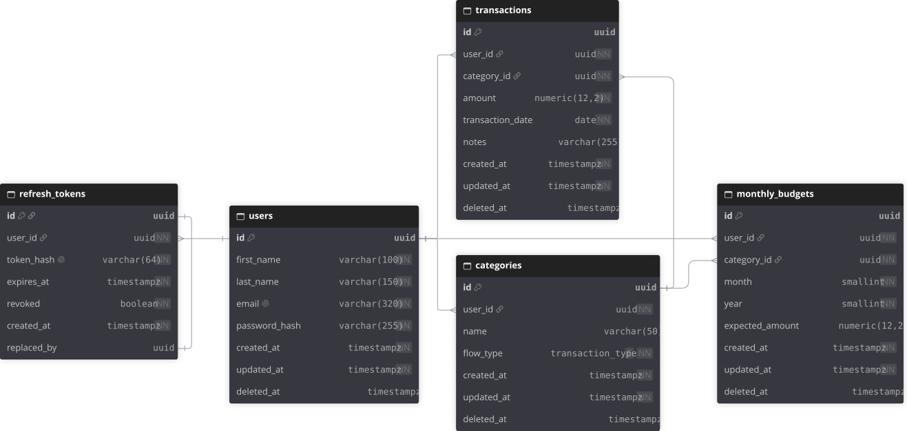

# Oikonomía API

API REST para llevar el seguimiento de gastos personales. Construida como monolito modular, arquitectura hexagonal y
autenticación con JWT.

## Contenido

- [Sobre el proyecto](#sobre-el-proyecto)
- [Funcionalidades](#funcionalidades)
- [Stack](#stack)
- [Arquitectura](#arquitectura)
- [Estructura del código](#estructura-del-código)
- [Modelo de datos](#modelo-de-datos)
- [Seguridad](#seguridad)
- [API](#api)
- [Pruebas](#pruebas)
- [Calidad y CI/CD](#calidad-y-cicd)
- [Primeros pasos](#primeros-pasos)
- [Comandos](#comandos)
- [Frontend](#frontend)
- [Retos técnicos y lecciones aprendidas](#retos-técnicos-y-lecciones-aprendidas)
- [Contacto](#contacto)
- [Licencia](#licencia)

## Sobre el proyecto

Saber cuánto ganas y cuánto gastas es importante. Mi forma de llevar el seguimiento de mis gastos e ingresos consistía
en un Excel con una tabla y gráficos. En un principio era suficiente, pero comenzaron a surgir detalles que me
incomodaban su uso:

- **No era responsivo:** Me resultaba más cómodo utilizarlo en mi computadora.
- **Bugs:** Agregar nuevas categorías producía el típico error de desbordamiento. Constantemente tenía que hacer ajustes
  para soportar un rango mayor de celdas.
- **La tabla crecía**: No podía filtrar las transacciones por mes porque rompía las gráficas y los cálculos.
- **La más importante**: Venció la licencia que me proporcionaba mi universidad. No quería repetir la plantilla en otra
  alternativa.

La mayoría de problemas sencillos se solucionan con una hoja de cálculo (si se sabe hacerlo bien), pero en esta ocasión,
me di cuenta de que tenía un problema real. Era propio, pero serviría para tener un proyecto útil en mi portafolio y
poner en práctica mis habilidades como ingeniero de software.

Actualmente, me estoy concentrando en tener listo un MVP en lugar de tratar de tener el proyecto perfecto. Mi idea es
usar sus funcionalidades básicas, darme cuenta de que le falta, qué sería útil y proponer cambios absurdos (ventajas de ser
mi propio usuario).

También pienso agregar mejoras a la aplicación, como observabilidad, monitoreo y arreglar detalles de seguridad. Así que
el proyecto seguirá recibiendo actualizaciones de todo tipo.

### Funcionalidades

- Registro de usuarios, inicio y cierre de sesión.
- Gestión de categorías de ingresos y gastos.
- Gestión de transacciones por mes.
- Gestión de presupuestos mensuales por categoría.

Pendientes:

- Gráficas
- Autenticación con Google

## Stack

### Runtime & Framework

Mi lenguaje backend principal es Java. Uso Spring Modulith para aplicar la arquitectura de monolito modular.


### Base de Datos

No conozco PostgreSQL, así que fue una buena oportunidad para aprenderlo.


### Librerías


### Testing

Testcontainers facilita mucho las pruebas con la capa de persistencia. Incluí AssertJ porque me parece más natural leer
su API en lugar de las aserciones de JUnit.


### Calidad de Código

Estas herramientas me ayudan a mantener código formateado y a detectar posibles bugs.


### DevOps

Dejé un workflow preparado para el día que necesite desplegar un contenedor de Docker.


## Arquitectura

En pocas palabras, sigo la arquitectura cliente-servidor: una API REST y una aplicación web.

Era tentador utilizar microservicios para mostrar un proyecto complejo, pero también era demasiado para un proyecto
personal. Analicé mi problema y concluí que lo mejor era crear un monolito modular:

- Módulo de usuarios y autenticación
- Módulo de categorías
- Módulo de transacciones
- Módulo de presupuestos
- Módulo shared (abierto para los demás módulos)

Así mantengo una estructura limpia y mantenible, donde cada módulo es independiente. Para que los módulos de
transacciones y presupuestos accedan a la información de las categorías, utilizo puertos `Lookup`.

En un nivel más bajo, sigo la arquitectura hexagonal porque me gusta mantener separada la infraestructura de la lógica
de negocio. Además, me viene perfecto porque así el código está mejor preparado para los futuros cambios que tengo
planeados.

## Estructura del código

```text
.
├── .github/workflows/ci.yml                  Pipeline de CI
├── .githooks/                                Hooks pre-commit y pre-push
├── config/                                   Reglas de Checkstyle, PMD y Spotless
├── docs/
│   └── images/                               Diagramas y capturas
├── src/
│   ├── main/
│   │   ├── java/com/[paquete]/
│   │   │   ├── user/                         Autenticación y usuarios
│   │   │   │   ├── application/service/      Implementaciones de los casos de uso
│   │   │   │   ├── domain/
│   │   │   │   │   ├── exception/            Excepciones de dominio
│   │   │   │   │   ├── model/                Entidades de dominio con lógica de negocio
│   │   │   │   │   └── port/
│   │   │   │   │       ├── in/               Casos de uso y comandos
│   │   │   │   │       └── out/              Puertos de salida
│   │   │   │   └── infrastructure/
│   │   │   │       ├── in/rest/              Controladores, DTOs y mappers
│   │   │   │       └── out/persistence/jpa/   Adaptadores, repositorios, entidades JPA y mappers
│   │   │   ├── category/
│   │   │   ├── transaction/
│   │   │   ├── budget/
│   │   │   └── shared/                       Kernel compartido (módulo abierto)
│   │   └── resources/
│   │       ├── application.yaml              Configuración base y perfiles
│   │       └── db/migration/                 Migraciones de Flyway
│   └── test/java/                            Pruebas (espejo de main)
├── Dockerfile
├── docker-compose.yml
├── .env.example
└── pom.xml
```

## Modelo de datos

En el código, las entidades JPA no reflejan las relaciones porque están en módulos separados. La base de datos sí
contiene relaciones:



Características:

- Campos de auditoría
- Soft delete
- Índices `UNIQUE` parciales para permitir reutilizar nombres tras una eliminación lógica
- `TYPE ENUM` nativo para el tipo de flujo
- `CHECK` para asegurar reglas de negocio
- Migraciones versionadas con Flyway

## Seguridad

Utilizo jsonwebtokens para la autenticación sin estado:

- **access token:** se recibe como `Bearer token` para autenticar la petición. Es de corta duración.
- **refresh token:** se maneja como Cookie para emitir un nuevo access token. Tiene mayor duración.

Así manejé algunos problemas de seguridad:

- **Robo de tokens por XSS:** El refresh token se manda como una cookie `HttpOnly`. El refresh token se guarda en la
  memoria del frontend, no en local storage.
- **CSRF:** `SameSite=Strict` y `Path` acotado a `/api/v1/auth`.
- **Refresh token robado:** Se rota el refresh token cuando se usa. Si se detecta que se usa un refresh token ya rotado,
  revoca todas las sesiones.
- **Tipos de tokens**: Se valida el claim `type` en el filtro JWT.
- **Base de datos filtrada:** Las contraseñas se almacenan con BCrypt y los refresh tokens como hash SHA-256.
- **Enumeración de usuarios:** Un login incorrecto no distingue si fue por el email o contraseña.
- **Datos del usuario:** Todas las consultas filtran por el `id` del usuario.

Pendientes:

- Rate limiting
- Mitigación de ataque de temporización en el login
- El access token revocado sigue siendo vigente hasta que expira
- Logout cierra todas las sesiones, no solo una

## API

Documentación interactiva con [Swagger](http://localhost:8081/swagger-ui/index.html#/) (deshabilitada en producción).


Convenciones:

- Rutas versionadas y anidadas
- Los recursos con sustantivos, no verbos
- `ProblemDetail` para dar formatos a los errores (RFC 9457)
- `POST` no devuelve el recurso, devuelve una cabecera con la ruta del endpoint para obtenerlo
- `PUT` y `DELETE` devuelven `204`

## Pruebas

Más de 350 test:

- Pruebas unitarias para validar las invariantes de los modelos de dominio. Utilicé JUnit y AssertJ.
- Pruebas unitarias de servicios. Utilicé Mockito para simular el comportamiento de otros componentes.
- Pruebas de persistencia en los adaptadores para validar consultas, restricciones y modificaciones en una base de datos
  real. Estas pruebas se ejecutan en Testcontainers.
- Pruebas de extremo a extremo en el flujo completo de autenticación. RestTestClient y Testcontainers me permiten
  levantar un servidor donde probar.
- Prueba de arquitectura para validar los límites entre módulos con Spring Modulith.

Considero que esta parte es una de las más importantes. Aprendí a diseñar pruebas, manejar todos los casos posibles y a mockear objetos. También me ayudó a descubrir bugs y problemas de seguridad. Ahora, cada vez que toco algo, simplemente ejecuto los test y me aseguro de que todo sigue funcionando.

## Calidad y CI/CD

Me gusta que las decisiones de formateo y codificación las tomen las herramientas. Así la integré en mi flujo de
desarrollo:

- **Hooks locales:** `pre-commit` válida el formato con Spotless. `pre-push` válida codificación y tests.
- **CI:** GitHub Actions ejecuta verify con Testcontainers. Al integrar en main o develop, construye la imagen.
- **Docker:** Multietapa, aprovecho las capas separadas de Spring Boot para optimizar la imagen.
- **CD:** próximamente

## Primeros pasos

### Requisitos

- JDK 25
- Docker para pruebas

### Arranque

Después de clonar el repositorio:

```bash
# Crear archivo de variables de entorno
cp .env.example .env # Unix
copy .env.example .env # PowerShell
# Editar .env con JWT_SECRET y credenciales de la base de datos

# Levantar base de datos
docker compose up -d

# Levantar API
./mvnw spring-boot:run # Unix
./mvnw.cmd spring-boot:run # Windows
# Si se levanta desde el IDE, hay que indicarle que use el archivo .env y el perfil dev
```

La API queda en [http://localhost:8081](http://localhost:8081). Para levantar la API en un contenedor:

```bash
docker compose --profile app up -d --build
```

### Variables de entorno

| Variable                 | Obligatoria | Por defecto | Descripción                                  |
| ------------------------ | ----------- | ----------- | -------------------------------------------- |
| `JWT_SECRET`             | Sí          | —           | Secreto de firma de los JWT, mínimo 32 bytes |
| `DB_URL`                 | Sí          | —           | URL JDBC de PostgreSQL                       |
| `DB_USERNAME`            | Sí          | —           | Usuario de la base de datos                  |
| `DB_PASSWORD`            | Sí          | —           | Contraseña de la base de datos               |
| `SERVER_PORT`            | No          | `8081`      | Puerto de la API                             |
| `SPRING_PROFILES_ACTIVE` | No          | —           | `dev` para desarrollo local                  |

## Comandos

En Linux, macOS y Git Bash se usa `./mvnw`. En Windows `./mvnw.cmd`.

Compilar y empaquetar sin pruebas:

```bash
./mvnw -B package -DskipTests
```

Ejecutar pruebas y validaciones de spotless, Checkstyle y PMD:

```bash
./mvnw verify
```

Aplicar el formato:

```bash
./mvnw spotless:apply
```

Ejecutar API:

```bash
./mvnw spring-boot:run
./mvnw spging-boot:run -Dspring-boot.run.profiles=dev # Con perfil dev
./mvnw.cmd spging-boot:run "-Dspring-boot.run.profiles=dev" # Windows
```

Construir imagen:

```bash
docker build -t oikonomia-api .
```

Levantar solo la base de datos:

```bash
docker compose up -d
```

Levantar base de datos y API

```bash
docker compose --profile app up -d --build
```

Ver los logs de la API:

```bash
docker compose logs -f api
```

Detener y borrar los datos:

```bash
docker compose --profile app down -v
```

## Frontend


[Repositorio](https://github.com/JSamuelAP/oikonomia-ui) del cliente web. Construido con Angular 22, PrimeNG, TailwindCSS
y Signal Forms.

## Retos técnicos y lecciones aprendidas

| Problema                                        | Causa                                                                           | Solución                                                                        |
| ----------------------------------------------- | ------------------------------------------------------------------------------- | ------------------------------------------------------------------------------- |
| La revocación de sesiones por reuso se deshacía | Lanzaba una excepción que después revertía la transacción                       | `noRollbackFor` en el caso de uso y una prueba de extremo a extremo que lo fija |
| `INSERT` en lugar de `UPDATE` al guardar        | El dominio genera el UUID, así que Hibernate creía que la entidad ya existía    | `Persistable` con un indicador de entidad nueva                                 |
| Un nombre eliminado no se podía reutilizar      | Restricción `UNIQUE` que contaba también las filas eliminadas                   | Índices únicos parciales                                                        |
| Un módulo dependía de un tipo interno de otro   | Una vista pública exponía un enum del dominio                                   | Exponer solo tipos primitivos y verificar con Modulith                          |
| Una prueba pasaba en local y fallaba en CI      | Un mock sin configurar devolvía `Duration.ZERO` y el reloj de Linux es más fino | Configurar el valor y acertar el rango de fechas                                |
| Diferencias entre Windows y Linux               | Finales de línea y permisos de `mvnw`                                           | `.gitattributes`, `.editorconfig` con eol LF y permiso de ejecución en git      |
| Configurar la carpeta `.githooks/`              | Obligaba al desarrollador a ejecutar otro comando al iniciar                    | Perfil que ejecuta el comando automáticamente                                   |

## Contacto

[](https://www.linkedin.com/in/jsamuelap/)

[](https://github.com/JSamuelAP)

[](mailto:sp4619168@gmail.com)

## Licencia

El código fuente de este proyecto está licenciado bajo la licencia [MIT](https://choosealicense.com/licenses/mit/).

Todos los recursos visuales (logotipos, imágenes, capturas de pantalla, marca personal) NO están cubiertos por esta
licencia y no pueden reutilizarse sin permiso explícito.
